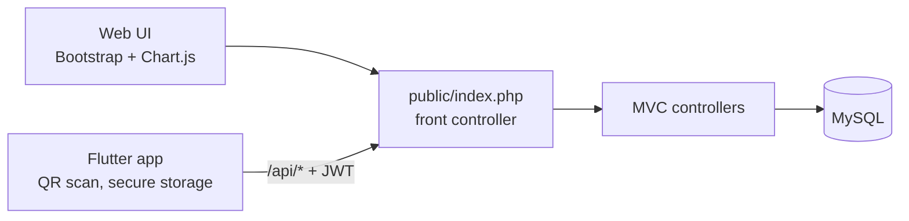
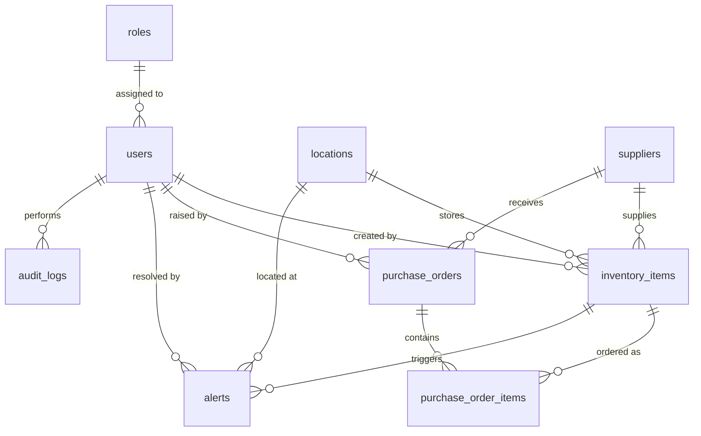

# 7NVENT

Hotel inventory and purchase-order management with QR stock scanning, role-based access and a Flutter companion app.

Built as a final-year project (CSC2854) at Kolej Profesional MARA Beranang. PHP MVC on the server, MySQL for storage, a JSON API secured with JWT for the mobile client.

<!--
Add screenshots here once you have them, then delete this comment:


-->

## Highlights

- **Inventory control:** items by category and location, par levels, expiry dates and FIFO flags, with status updating automatically.
- **Alerts pipeline:** par-level breaches and expiry warnings are raised for review, then approved or dismissed.
- **QR scanning:** look up and log stock from the browser or from the Flutter app, with a scan log kept for review.
- **Purchase orders:** create orders against suppliers, track status, and get automatic numbering.
- **Reports and analytics:** stock summary, PO history, waste and expiry reports, plus a Chart.js dashboard.
- **Access and accountability:** six roles with role-based permissions, an audit trail for every action, session timeout and login lockout.
- **Mobile API:** the Flutter app talks to `/api/*` endpoints using stateless JWT bearer tokens.

## Architecture



## Data model



The `settings` table holds system configuration and has no relations.

## Tech stack

| Layer | Technology |
|---|---|
| Backend | PHP 8.1+, MVC pattern, PDO |
| Database | MySQL 8 |
| Web frontend | Bootstrap 5.3, Bootstrap Icons, Chart.js 4.4 |
| Mobile | Flutter (Dart), `mobile_scanner`, `flutter_secure_storage` |
| API auth | JWT bearer tokens |
| Testing | PHPUnit 10 |
| Local server | XAMPP (Apache) |

## Getting started

1. Install [XAMPP](https://www.apachefriends.org) and start **Apache** and **MySQL**.
2. Clone this repository into `C:\xampp\htdocs\7nvent`.
3. Open `http://localhost/phpmyadmin`, create a database named `7nvent`, then import `database/7nvent_schema.sql`. This creates the tables and demo data.
4. Copy `config/config.example.php` to `config/config.php`, then set the database values and a new `JWT_SECRET`.
5. Make sure `mod_rewrite` is enabled. The `.htaccess` in `public/` handles clean URLs.
6. Open `http://localhost/7nvent/public/`.

### Demo accounts

Seeded for local development only. Change or remove them before any real deployment.

| Username | Password | Role |
|---|---|---|
| `elizabeth.lee` | `password` | Inventory Manager (full access) |
| `sarah.qinn` | `password` | Procurement Officer |
| `farah.nabilah` | `password` | Hotel GM (reports and approvals) |

### Tests

```bash
composer install
composer test
```

### Mobile app

```bash
cd mobile_app
flutter pub get
flutter run
```

Point the app at your server's `/api` address (see `mobile_app/lib/core`).

## Roles and permissions

| Role | Inventory | Alerts | Purchase orders | Reports | Users | Settings |
|---|---|---|---|---|---|---|
| Inventory Manager | Full | Full | Full | Full | Full | Full |
| Housekeeping Manager | View, update | View | View | View | No | No |
| Procurement Officer | View | Approve | Full | View | No | No |
| IT Administrator | View | View | View | View | Full | Full |
| Hotel GM | View | View | View | Full | No | No |
| Supervisor | View | View | View | View | No | No |

## Security notes

- Passwords are hashed with bcrypt (`password_hash()`).
- Sessions expire after 30 minutes of inactivity. Three failed logins lock the account for 15 minutes.
- Every action is written to the audit log with timestamp, user and IP address.
- Mobile tokens are signed with `JWT_SECRET` and expire after 12 hours.
- `setup.php` is a one-time installer. Delete it after installation, and keep `display_errors` off outside local development.

## Project structure

```
app/                  Controllers, authentication, database access
config/               Configuration (copy config.example.php to config.php)
database/             Schema and seed data
mobile_app/           Flutter client
public/               Front controller and .htaccess
resources/views/      Layouts and page templates
tests/                PHPUnit tests
docs/                 Project report and test report
```
